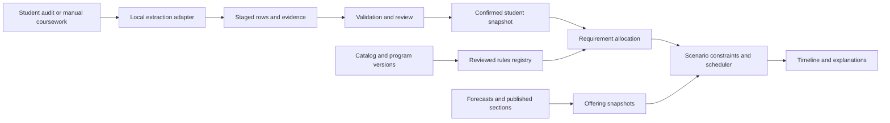

# DegreePath data pipeline and coverage plan

Research and implementation status: November 16, 2026. Target: **all current KSU degrees and programs**, with explicit per-program support stages. This is a plan and a tested intake foundation, not an implemented DegreeWorks importer or university-wide audit engine.

## What exists now

The visible app still uses the original 18-course fictional graph, two explicitly completed prerequisite nodes, and a greedy scheduler. It supports one deferred or excluded course at a time. All courses are mandatory and assumed to run every fall/spring. It cannot yet accept a student's coursework, add arbitrary courses, allocate credits across programs, or calculate official eligibility.

New files are intentionally separate from that UI:

- `src/data/contracts.ts`: proposed versioned domain types.
- `src/data/intake.ts`: pure normalized-JSON staging and validation; no current record is overwritten.
- `data/fixtures/`: 48 invented courses, three synthetic 120-credit programs, 576 invented offering records, six student fixtures, two invalid imports, and ten future scenario acceptance cases.
- `data/research/ksu-program-discovery.json`: 291 names from eight official directory categories. Names are discovered; catalog years, active status, rules, and schedules are not verified.
- `data/research/ksu-forecast-observations.json`: three small real forecast observations, separated from synthetic data. These are not registration sections or degree rules.

The new intake is not wired to the website. Its `readyToPlan` remains false by design: structural validation is not academic clearance. The ten scenario cases describe expected properties for future work; they are not ten passing generalized scheduling tests.

## Research findings and limits

| Finding | Evidence | Consequence |
| --- | --- | --- |
| Audit rules depend on catalog year; KSU says DegreeWorks reflects Banner changes within 24–48 hours | [KSU Registrar](https://campus.kennesaw.edu/current-students/registrar/student-resources/academic-records/degree-works.php) | Store audit date, import date, student catalog, and newer enrollment corrections separately. Do not automatically replace a student's catalog with the newest year. |
| PDF export exists in at least one documented DegreeWorks deployment | [Missouri State DegreeWorks 5.1.6 guide, print/PDF section](https://www.missouristate.edu/Registrar/_Files/DWUsersGuide516Registrar.pdf) | A user-provided PDF is a plausible first adapter. KSU's exact export and layout have not been verified. One university's PDF is not a universal schema. |
| Institutional integration is credentialed | [Ellucian Ethos SDK](https://ellucian-developer.github.io/integration-sdk-doc/csharp/index.html) | The public SDK requires a configured application's API key. It does not prove this team can query KSU audits or that a universal DegreeWorks endpoint is available. |
| Forecasts can change and have a limited horizon | [KSU course forecasts](https://campus.kennesaw.edu/current-students/academics/academic-advising/resources/course-forecasts-1.php) | Model forecast, published schedule, historical pattern, and unknown independently. Blank future cells and explicit dashes are different. |
| The advising page links a 2026–27 CS catalog and a suggested map | [KSU Computer Science advising](https://campus.kennesaw.edu/current-students/academics/academic-advising/explore-majors/computer-science.php) | This is a source-discovery lead. The linked catalog returned HTTP 403 to this research tool; its full rules were not reviewed. Older curriculum sheets are not substitutes for that edition. |
| KSU already recommends combining remaining audit requirements, prerequisites, and forecasts | [CCSE student resources](https://campus.kennesaw.edu/colleges-departments/ccse/resources/index.php) | Our workflow can automate that reconciliation, with evidence and uncertainty. |
| Vendor products already advertise adaptive planning and timeline changes | [Ellucian Student Success](https://www.ellucian.com/products/student/student-success) | Ask which features KSU licenses/enables. Pitch the demonstrated student workflow rather than claiming no existing product can do it. |

KSU Program Finder also returned 403 here. Direct laptop requests to the public directory failed, while web research could read its eight category pages. The saved index comes from that readable source, not a working deployed scraper. The public class-search term selector was reachable, but automated section-query access was not verified. Academic Maps rendered no extractable text in the research tool. No university credentials or student records were accessed.

## The pipeline

The audit supplies evidence about this student's progress. The catalog supplies reusable rules; the offering source supplies temporal availability. None replaces the other two. Store parsed audit allocations as reported evidence and compare our evaluation against them; a discrepancy requires investigation, not silent substitution.

## Canonical data boundaries

| Entity | Important fields and invariants |
| --- | --- |
| Program discovery entry | Institution, credential category, title, discovery source/date; nullable program-version link. Discovery is not eligibility support. |
| Program version | Stable program ID, exact catalog, degree level, concentration/pathway, admission conditions, minimum/residency/upper-level credits, course and non-course requirements. A master's, minor, endorsement, and bachelor's must not share an assumed 120-credit rule. |
| Course version | Stable ID, code and aliases, credits/range, repeatability, grade-aware AND/OR prerequisites, concurrent conditions, corequisite bundle, equivalency/cross-list rules, evidence IDs. Code alone is not globally unique across institutions/years. |
| Requirement tree | All-of, choose-N, choose-credit, category/elective limits, exclusions, minimum grades, sharing rules, residency, and exceptions. The current code models only an initial subset. |
| Student snapshot | Local opaque ID, academic level, program/catalog, audit timestamp, attempts, current enrollment, evaluated transfer credit, explicit exceptions, review state. Minimize direct identity information. |
| Course attempt | Unique attempt ID, original code/title, institution, term, attempted and earned credits, grade/status, mapped course ID or unresolved null, equivalency status, source location. Never collapse distinct attempts merely because the course repeats. |
| Audit evidence | Reported requirement blocks, applied coursework, unmet conditions, in-progress work, exceptions, issue/refresh date, document/page/line locator, extraction confidence and user corrections. |
| Offering/section | Course, term/session, campus, format, status, expected/not-expected/unknown, source/date; optional confirmed section times/seats. A forecast is not a reserved seat. |
| Scenario draft | Immutable student/rule snapshot IDs, ordered operations, preferences, pins, revision, previous valid result. Changing a scenario never changes the actual transcript or registration. |
| Plan result | Feasible/infeasible/needs-review/search-limit status, term assignments, baseline deltas, blocked reasons and evidence, availability assumptions. Completion is withheld if unresolved mandatory conditions prevent evaluation. |

Proposed storage: public/versioned rule snapshots can be JSON for the hackathon. Keep private student drafts in browser-local IndexedDB with a visible delete/export path; use localStorage only for small preferences. A future backend can use relational tables for versioned programs, courses, attempts, and sources, with JSON expression trees and immutable revisions. Do not build a full ETL platform before proving one complete adapter/evaluator round trip. [IndexedDB reference](https://developer.mozilla.org/en-US/docs/Web/API/IndexedDB_API)

## Import that does not break mid-input

1. Begin with manual entry and normalized JSON so the evaluator has a stable boundary. Verify KSU's actual export with a redacted, consented sample before writing its adapter.
2. For text PDFs, evaluate browser-local PDF.js extraction. Preserve page coordinates/lines, not just one flattened string. Headers, wrapped titles, repeated requirement blocks, and lecture/lab suffixes must survive. Image-only, encrypted, or unsupported documents should return a recoverable message; OCR is a separate later capability. [PDF.js examples](https://mozilla.github.io/pdf.js/examples/)
3. Show an import preview: completed, in progress, withdrawn/repeated, transfer, unresolved. Keep raw fields beside normalized values. AI extraction may propose rows, never silently approve them.
4. Validate all rows before applying anything. Preserve unknown grades/codes and source evidence. Ask for grade/equivalency review rather than treating them as passed prerequisites.
5. Use a confirmed transactional replacement/merge with a diff: added, changed, duplicate, unresolved. A cancelled or failed import leaves the current record untouched. The new pure staging function supports this boundary; UI confirmation and persistence are not built yet.
6. Assign stable attempt IDs within a snapshot. Distinguish a row repeated in two audit blocks from two genuine course attempts. Reimport the same snapshot idempotently. Do not deduplicate solely by course code.
7. Autosave editable drafts independently of parsing. Debounce validation, keep focus/cursor stable, and avoid replacing the entire page DOM per keystroke. That requires refactoring the current whole-page render approach before bulk editing.
8. Run parsing and scheduling off the main input path. Associate requests with monotonically increasing draft revisions; cancel/ignore older results. Show the last valid plan with an explicit stale/recalculating state, not a fabricated finish.

Implemented intake limits are 2 MiB of normalized JSON and 2,000 attempt rows. These limits do not describe an implemented PDF upload limit or prove interactive performance. A performance benchmark and persistence-failure checks remain tasks.

## Add, drop, defer, and compare

- **Remove from a term:** reschedule required coursework or leave it unmet; do not erase the requirement.
- **Permanently avoid a course:** seek a permitted alternative; otherwise return infeasibility for the current degree.
- **Add a course:** validate eligibility, offerings, credit cap, duplication, and degree applicability. An extra course can be feasible without advancing the degree, and it can displace a required course.
- **Project withdrawing/failing current work:** alter projected eligibility while preserving actual enrollment/attempts. Actual add/drop registration stays in Owl Express; the app does not perform it.
- **Move later:** distinguish an earliest allowed term from an exact placement. Preserve unaffected pins when possible and explain every moved course.
- **Compare programs:** evaluate completed credit under each target program/catalog's allocation and sharing rules before scheduling. A credit-overlap percentage is not an audit.

First scheduling objective proposal: feasible complete plan, then earliest finish, then least disruption, then balanced workload. Let users choose a different objective explicitly. For annual offerings, search past empty terms instead of stopping because one term has no eligible courses. Bundle corequisites, validate hard-prerequisite cycles, and represent unknown rules without granting eligibility. Keep integer credit units if evaluating CP-SAT; report feasible versus proven optimal and distinguish timeout from infeasibility. Solver choice is still a design decision. [OR-Tools solver statuses](https://developers.google.com/optimization/cp/cp_solver)

## Covering all current KSU programs

The discovery snapshot contains 74 bachelor entries, 50 master's, 5 specialist, 10 doctoral, 98 minors, 16 undergraduate certificates, 31 graduate/postgraduate certificates, and 7 endorsements. These are 291 directory entries, not 291 proven unique active degrees or supported evaluations. Sources are the eight category pages under [KSU Degrees and Programs](https://www.kennesaw.edu/degrees-programs/).

Use this progression for every program/catalog version:

`name_discovered → catalog_pinned → rules_parsed → rules_reviewed → audit_matched → schedule_tested`

Maintain a coverage dashboard with exact remaining unsupported rules. Review shared core/policy blocks once per version and reuse them; program-specific admission, tracks, clinical placements, studio sequences, thesis/dissertation/candidacy milestones, and permissions remain explicit. Graduate/dual-degree comparisons need rules for level/admission/shared credit, not just the undergraduate course engine. “Latest” discovery and a continuing student's catalog entitlement are different questions.

For tomorrow's demonstration, prove the architecture on reviewed slices and label the remaining inventory accurately. The full university scope stays on the roadmap; a directory is not a reason to expose unsupported graduation claims.

## Recommended navigation

Add **My coursework** next: import/manual entry, completed/in-progress work, corrections, and an unresolved-item count. Add **Requirements & sources** after the evaluator exists: met/unmet groups, catalog edition, source freshness, and unsupported conditions. Put offering evidence in course details; put preferences in the planning view. Retain My plan, Compare paths, and Saved plans. Defer a standalone chat page, analytics dashboard, or extra landing page until there is a demonstrated user task.

## Tomorrow's decisions

Confirm judging rules and allowed pre-existing work; inspect a redacted KSU export; pin the current catalog sources across the inventory; choose who reviews rules and expected audits; define add/drop semantics and scheduling objective; decide whether AI interprets preferences or extracts draft rows; test a no-delay deferral, a delayed bottleneck, and a blocked mandatory course. Keep a deterministic offline demo and be clear about which data is synthetic.

The next blockers are source completeness, reviewable rules, student/audit reconciliation, and a general evaluator. More frontend styling or a larger mock graph alone will not resolve them.
